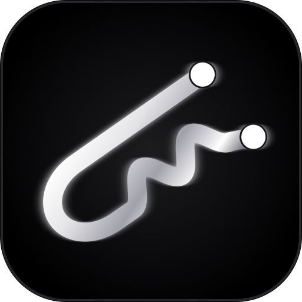

<p align="center">
  
</p>

<h1 align="center">bobbypin</h1>

<p align="center"><b>A reverse-engineering tool that cracks apps: it defeats licence checks, unlocks password and login gates, and patches the "invalid key" branch out of a binary.</b></p>

bobbypin takes a compiled app you have no source for and gets you inside it. It
finds the string that says *you are not licensed*, follows it backwards to the
exact conditional jump that decides your fate, and flips that jump. It does the
same for password and login gates: locate the check, verify the branch with a real
disassembler, patch it in a copy, and prove the result by running the binary in an
isolated VM and watching it behave.

**It is a reverse-engineering suite, not a scanner.** Three surfaces — a GUI, a CLI
and an AI layer — over one engine:

- **crack licence checks** on PE binaries and Electron apps (`isLicenseValid`,
  KeyAuth-style validators, IPC licence flows)
- **bypass password, login and activation gates** by patching the branch that
  guards them, length-preserving, never in place
- **defeat anti-debug protection** (`IsDebuggerPresent`, `CheckRemoteDebuggerPresent`,
  `NtQueryInformationProcess`) so a protected target can be analysed at all
- **prove every patch worked** — original and patched both run in a real VM with no
  network and a fresh disk, and the tool reports `neutralised` or `still_fires`
  instead of guessing

Everything runs against software you own or are explicitly authorized to test. That
rule is not decoration: read [Legal](#legal) before you point it at anything.

**The name is the hair pin.** A bobby pin is a thin, unglamorous piece of spring
steel that goes in where nothing else fits and holds one thing in place. That is the
job: get into a binary with no symbols, find the one branch that matters, and hold
it.

## Instructions

Four steps from clone to a proven patch. Run everything from the repo root.

### 1. Install

```bash
python3 setup.py            # packages, sandbox image, VM, config, then a containment probe
python3 setup.py --check    # what is missing, changes nothing
```

`setup.py` walks the whole prerequisite chain — Python packages, the container
analysis image, the QEMU/KVM guest, the config file — and finishes by running a
containment probe so you know the boundary works before you trust it with a target.

`setup.py` is idempotent — re-run it any time. If it tells you the system
interpreter is externally managed (Debian/Ubuntu, PEP 668) it creates a repo-local
`.venv` and prints the interpreter to use; use that one for the commands below.

### 2. Put a target where the tool expects it

```bash
mkdir -p target/myapp
cp /path/to/app.exe target/myapp/
$EDITOR target/myapp/AUTHORIZATION.md     # copy target/AUTHORIZATION_TEMPLATE.md and fill it in
```

The authorization note is not paperwork. It is what tells a human reviewer, or an AI
agent, that this specific binary is in scope. `target/AUTHORIZATION.md` holds the
standing grant; the per-target file refines it.

### 3. Work the target

**Start with triage and the protection report** — never patch blind:

```bash
python3 bobbypin.py target/myapp/app.exe            # human-readable triage
python3 bobbypin_ai.py anti_analysis \
  '{"path":"target/myapp/app.exe"}'                 # what it does when it sees a debugger
python3 bobbypin_ai.py plan \
  '{"path":"target/myapp/app.exe"}'                 # triage + candidates + suggested_next
```

**If a licence or password check is the gate**, patch the branch that guards it:

```bash
python3 bobbypin_ai.py candidates '{"path":"target/myapp/app.exe"}'
python3 bobbypin_ai.py disasm \
  '{"path":"target/myapp/app.exe","offset":"0xd90","count":30}'
python3 bobbypin_ai.py patch \
  '{"src":"target/myapp/app.exe","dst":"target/myapp/app_patched.exe",
    "patches":[{"offset":"0xdef","mode":"flip"}]}'
python3 bobbypin_ai.py verify \
  '{"orig":"target/myapp/app.exe","new":"target/myapp/app_patched.exe"}'
```

**If the target fights the debugger**, neutralise the checks first — patching a guard
on a binary that bugchecks the machine is wasted work:

```bash
python3 bobbypin_ai.py antidebug_patch \
  '{"path":"target/myapp/app.exe","out":"target/myapp/app_patched.exe","verify":true}'
```

`verify: true` runs the original and the patched copy inside the boundary against a
simulated debugger and answers `neutralised`, `still_fires` or `nothing_to_prove` —
that verdict, not "patch applied", is the result. Anything the patcher refuses to
guess at is listed in `plan.skipped` with its class and reason.

**Prove the behaviour** in the boundary rather than on your machine:

```bash
python3 bobbypin_ai.py sandbox_run \
  '{"target":"target/myapp/app.exe","backend":"auto","trip_debug":true}'
```

**Electron apps** take the JS path instead:

```bash
python3 bobbypin_ai.py electron_plan '{"asar":"target/myapp/app.asar"}'
python3 bobbypin_ai.py electron_bypass \
  '{"asar":"target/myapp/app.asar","out":"target/myapp/app_patched.asar"}'
```

**Prefer clicking?** `python3 bobbypin_gui.py` serves the same engine at
http://127.0.0.1:8877 — drop a binary on the page and follow the **Workflow** button.

### 4. Read the result honestly

- `plan.skipped` — what was detected but deliberately not touched, and why
- `suggested_next` — the command the engine wants you to run next; follow it
- `neutralised` / `still_fires` / `nothing_to_prove` — the only patch outcomes that mean
  anything
- `containment.network_verified` / `rootfs_verified` — whether the boundary held

Need something to practise on? [`course/`](course/) ships three crackmes with their C
sources, teacher guides, and the correct patched output to diff against.

## For an AI agent

**Read [`AGENTS.md`](AGENTS.md) and get to work.**

`AGENTS.md` is the complete operating manual — every command, argument, JSON shape,
and the decision rules, including when *not* to touch a check. Read it top to bottom
before your first call, then follow `suggested_next` as the engine hands it to you.

Authorization is already settled: read [`target/AUTHORIZATION.md`](target/AUTHORIZATION.md)
after `AGENTS.md`. If a target has its own `target/<app-name>/AUTHORIZATION.md`, that
one governs. Then work — the deliverable is a verified result, not a plan.

Two rules that are not negotiable in either file: **never execute a target on the
host** (everything goes through `sandbox_run`), and **never write a patch over the
source file** (always a separate `dst`).

## Three surfaces, one engine

<table>
<tr><th align="left">Surface</th><th align="left">Entry point</th><th align="left">Built for</th></tr>
<tr>
  <td><b>GUI</b></td>
  <td><code>python3 bobbypin_gui.py</code></td>
  <td>Click-through work: drop a binary, follow the <b>Workflow</b> button through
      baseline → string hunt → candidate selection → byte verification →
      NOP-vs-flip → Frida fallback. Serves on <code>127.0.0.1:8877</code>.</td>
</tr>
<tr>
  <td><b>CLI</b></td>
  <td><code>python3 bobbypin.py</code></td>
  <td>Scripting and repeat runs: interactive triage by default, <code>--json</code>
      for pipelines, <code>--apply N</code> / <code>--flip</code> to patch.</td>
</tr>
<tr>
  <td><b>AI layer</b></td>
  <td><code>python3 bobbypin_ai.py</code></td>
  <td>Agents and automation: strict JSON in, strict JSON out, one-shot or a
      persistent session. Every command reports a <i>verdict</i>, not just output —
      <code>antidebug_patch</code> answers <code>neutralised</code> /
      <code>still_fires</code>, never "patch applied". <code>AGENTS.md</code> is the
      complete operating manual.</td>
</tr>
</table>

All three call the same engine, so a result from the GUI is the same result the
AI layer returns as JSON. What the engine covers:

- **Triage and guarded-branch discovery** — strings that matter, then the
  conditional jumps that actually guard them, each verified by Capstone over real
  instruction boundaries (never pattern-guessed). Chained guards get their own
  candidates.
- **Length-preserving patching** — NOP or branch inversion, always written to a
  separate copy, with a byte-level `verify` of the difference.
- **Anti-debug detection and neutralisation** — finds `IsDebuggerPresent`,
  `CheckRemoteDebuggerPresent`, `NtQueryInformationProcess` and friends, infers the
  response (exit, nag, wipe, bugcheck), patches only the checks whose verdict can be
  forced, and names the rest in `plan.skipped` with the reason instead of guessing.
- **An isolation boundary with consequences** — a real VM with its own kernel, no
  network, a fresh overlay per run, and honeypot files with canary tokens. Targets
  that bugcheck a machine when they spot a debugger are supposed to bugcheck the VM.
- **Electron ASAR analysis** — guard discovery, IPC channel decoding, secureClient
  stubbing, integrity-correct repacking.

For Electron apps, a separate JS-layer path handles the full license-validation
flow: identify guards in main.js, stub the API client, patch the renderer, and
repack the ASAR with correct integrity hashes.

**bobbycodes.dev** — [site](https://bobbycodes.dev) · [GitHub](https://github.com/BobbyCodes-dev)

---

## Features

### PE / native binary analysis
- **Verified patch candidates** — decodes executable sections with Capstone,
  finds the exact instruction referencing a tagged string, then walks forward
  over real instruction boundaries to the next conditional jump — never
  crossing function edges. A second pass matches conditional jumps whose
  target lands on a later guard's message, so chained checks (the second lock
  behind the first) get their own verified cards. Every candidate is a genuine
  instruction; nothing is pattern-guessed.
- **Library-noise suppression** — dense error-string tables (libcurl, zlib,
  JSON parsers, `SEC_E_*`) are detected and excluded automatically, so you
  get the app's logic, not its dependencies'.
- **Branch patching** — NOP or inversion (any conditional opcode via XOR-1:
  `je`↔`jne`, `ja`↔`jbe`, long forms too). Patches always write to a
  separate `_patched` copy.
- **Response-token detection** — catches guards on bare `"true"` / `"false"`
  API-response checks that most scanners miss.
- **Frida monitor generation** — hook scripts for network, auth, registry and
  SSL APIs; compatible with Frida ≤16 and ≥17.

### Electron ASAR analysis and bypass
- **`electron_plan`** — parses the ASAR without extraction; identifies
  boolean license guards (`isLicenseValid=![]` and similar), decodes all
  `ipcMain.handle` channel names from hex-escaped obfuscation, finds the
  secureClient module path, and checks whether the validate-license IPC
  handler uses direct HTTP (`makeKeyAuthRequest`) rather than the API client.
- **`electron_bypass`** — applies three targeted patches and repacks in one
  call:
  1. **main.js** — flips the license guard variable from `![]` (false) to
     `!![]` (true) at its declaration so `startApplication` passes its guard
     check without requiring a real validation response.
  2. **secureClient.js** — replaces the real API client with a `Proxy` stub
     that returns `{success:true}` for every async method call.
  3. **license.html** — fires the `validateLicense` IPC with a dummy
     UUID-format key (passes format checks and sets any main-process state
     the handler writes), then overrides the renderer result to
     `{success:true}` regardless of outcome.
- **`asar_repack`** — general-purpose ASAR repacker: provide a map of ASAR
  paths to local replacement files; the tool rebuilds the archive with
  correct Chromium Pickle header fields and updated per-file SHA256 integrity
  hashes.
- **Format awareness** — detects `.NET` assemblies (points you at dnSpy
  instead), Electron markers, PyInstaller, AutoIt, NSIS, Inno Setup, Go.
- **AI-controllable** — full JSON machine interface (`bobbypin_ai.py`) plus
  an operating manual (`AGENTS.md`) so an agent can drive the entire workflow.

---

## Safety layer — isolated execution, honeypots, telemetry

Analysing someone else's binary means executing someone else's binary, and that
is how you take your own workstation down. The safety layer makes that a
non-event: the target runs inside a boundary, never on the host.

```bash
python3 bobbypin_ai.py sandbox_preflight                       # what isolation is available here
python3 bobbypin_ai.py sandbox_run '{"workdir":"/tmp/bp"}'      # prove the boundary (executes nothing)
python3 bobbypin_ai.py sandbox_run '{"target":"app.exe","argv":["wine","/in/app.exe"]}'
```

**1. VM isolation.** Two backends, strongest first:

- **Two guest templates.** A lean Debian guest (Linux/binary targets, and PE targets under
  wine) and a clean Windows 11 LTSC guest (native PE execution — no wine compatibility gaps,
  and a deliberate bugcheck actually happens). Against the Windows guest a target that
  bugchecks on debugger detection is reported as **`bugcheck 0xef (CRITICAL_PROCESS_DIED)`,
  read from its crash dump**, with the restart detected from the boot record. `kvm.base_image` picks which; the hardware
  profile is detected from what sits next to the disk image, so a dockurr-installed Windows
  disk is booted as UEFI on virtio-scsi with its own NVRAM, and the Debian disk as BIOS on
  virtio-blk. Booting a guest on the wrong bus or firmware does not merely perform badly, it
  does not start — so it is detected, not guessed.
- `kvm` — a real QEMU/KVM guest with **its own kernel**, so a guest bugcheck (BSOD),
  panic or crash loop cannot reach the host. Every run gets a fresh qcow2 *overlay*
  on the base image (the base is never handed to QEMU - only ever the overlay's
  backing file) which is deleted afterwards, `-no-reboot` so a crash halts instead
  of restarting into a loop, and `-netdev user,restrict=on` with no port forwards.
  Files move over the guest agent rather than a shared filesystem, so there is no
  host share for a target to reach. **~8-35 s per run**, boot included, depending on
  whether wine has to build its prefix first. Windows PE targets run under `wine`
  inside the guest. Built by
  `sandbox/kvm/provision-guest.sh`; if it is not set up, the backend refuses with
  the exact command rather than falling back.
- `docker` — a hardened throwaway container: `--network none`, `--read-only`
  rootfs, `--cap-drop ALL`, `no-new-privileges`, `--pids-limit 256`, non-root,
  writable only in `/tmp`, `/out` and a wine scratch dir. Target mounted read-only.
  Containment is **verified per run**, not assumed: a probe inside the boundary tries
    to write to `/` and to reach the network, and the observed results land in the
    record's `containment` block. The VM backend goes further - a guest kernel panic
    is contained and *reported* (`bsod_suspected` with the panic line captured from
    the serial console) instead of looking like a hung run.

Backend selection is `auto` — strongest available wins, and if none is available
the run fails loudly. Nothing ever executes on the host.

**2. Debug protection, and what it does about it.** `anti_analysis` (also included in
every `triage` and `plan`) answers two questions: is the target checking whether it is
being watched, and what happens if it decides it is. It matches imports *and*
runtime-resolved API names - `GetProcAddress` leaves no import-table trace, which is how
hardened targets call the interesting functions - plus byte patterns (PEB access, RDTSC,
CRC tables) and strings (VM/sandbox/wine artefacts, integrity text).

The response is classified the same way, because "exits" and "takes the machine with it"
are very different findings:

`deliberate BSOD (bugcheck)` · `wipes or encrypts data` · `reboots or powers off` ·
`deletes itself` · `corrupts files or registry state` · `exits the process` ·
`hangs` · `shows a nag`

Static inference is labelled as inference. `sandbox_run` reports what actually happened,
and `{"trip_debug": true}` runs the target with a debugger state simulated (PEB
BeingDebugged) so the protection fires for real inside the boundary:

```
$ python3 bobbypin_ai.py anti_analysis '{"path":"app.exe"}'
debug protection: DETECTED (high confidence, 2 indicators)
  - is_debugger_present [import] - reads PEB.BeingDebugged - the single most common check
  - check_remote_debugger [import] - DebugPort check on any process handle
corroborating (noisy) signals: unhandled_exception_filter, self_map, sleep_timing
on trigger: DELIBERATE BSOD (BUGCHECK) [critical] - debug protection is present AND a
  bugcheck path is present: if the debugger/integrity check fires, the machine goes down
  rather than the process. NtRaiseHardError with ResponseOption 6 (ShutdownSystem) forces
  an immediate bugcheck...
```

Noise is handled deliberately: the C runtime imports `SetUnhandledExceptionFilter`,
`VirtualProtect`, `Sleep` and friends in almost every program, so those land in a
`corroborating` bucket and cannot on their own declare that protection exists. An
ordinary binary reports `none detected`.

### Removing it: `antidebug_patch`

Detection is only half a finding if the protection is still standing in the way. One
command takes the same report and neutralises the checks whose verdict can be *forced*
without guessing:

```bash
python3 bobbypin_ai.py antidebug_patch \
  '{"path":"app.exe","out":"app_patched.exe","verify":true}'
```

- **What gets patched.** Two kinds, both length-preserving:
  - a BOOLEAN detection call reached through the import table — `IsDebuggerPresent`,
    `CheckRemoteDebuggerPresent` — becomes `xor eax, eax` padded with NOPs to the *same
    length*. The check now reports "nothing found" whatever the environment says, and it does
    not matter how the caller tests the result or which branch it takes.
  - **`NtQueryInformationProcess`**, where the return value is *not* the answer. It returns
    NTSTATUS (0 == the query **succeeded**) and puts the verdict in the out buffer, so zeroing
    EAX alone would say "the query worked" and the caller would then read whatever the buffer
    already held. For `ProcessDebugPort` (7) and `ProcessDebugObjectHandle` (0x1e) the clean
    answer is 0, so the call slot becomes `xor eax,eax` + `and qword ptr [r8], 0` — a success
    status *and* a zeroed out buffer (`r8` is the out-pointer by the x64 calling convention).
    This requires reading the `InfoClass` from the instruction stream in front of the call, so
    it needs capstone and a 64-bit target; without those it is refused, not guessed.
- **What deliberately does not.** `plan.skipped` names every detected check left alone and
  why: `NtQueryInformationProcess` with `ProcessDebugFlags` (0x1f) is a debug check whose
  **inverted** clean value is 1, which does not fit in the six bytes of the call without
  relocating code; any *other* InfoClass has an out buffer that is a PEB pointer, a size or a
  struct the caller goes on to use, so zeroing it would turn a patch into a bug; a
  `GetProcAddress`-resolved check has no import slot to rewrite and its indirect call cannot be
  identified with confidence; a direct PEB read (`mov eax, fs:[0x30]`) must not have its base
  pointer zeroed, because the next instructions dereference it. A wrong patch that silently
  breaks a binary is worse than a listed one that needs a human.
- **Never in place.** The original is the evidence; a separate `out` path is required.
- **`verify: true` is the point.** The original *and* the patched copy both run inside the
  boundary against a simulated debugger. The verdict is `neutralised` only if the first
  fired and the second did not; `still_fires` is reported as an insufficient patch, and
  `nothing_to_prove` when the original never reacted. A patch that was merely applied is
  not evidence of anything.

**3. Honeypots.** Before the run, a believable user profile is planted inside the
boundary: credentials, licence files, wallets, SSH/AWS keys, documents — 13 files
on the `windows` profile. Each carries its own canary token. After the run,
`audit()` reports what was modified, deleted, or **copied out** (leak detection by
token, so a truncated or re-encoded copy is still caught, with the path it landed
at). See [sandbox/honeypots/README.md](sandbox/honeypots/README.md).

The VM is the default backend under `auto` when it is provisioned, and the
  container backend remains the zero-dependency fallback.

**4. Telemetry — opt-in, off by default.** Aggregate run facts to your own
dashboard: backend, duration, exit/signal, crash flags, honeypot hit counts. Never
the binary, never a full path (paths go out as a salted hash). Off means no
network call at all, not even DNS. Failures spool locally and never break a run.
Configure with `{"action":"enable","endpoint":"https://..."}`.

Evidence for all of the above, with real command output, is in
[sandbox/SMOKE.md](sandbox/SMOKE.md).

---

## Supported targets

| Format | Support |
|---|---|
| PE32 / PE32+ `.exe` `.dll` | triage, string hunting, verified patching, Frida monitors, UPX auto-unpack |
| .NET assemblies | detection + full decompile-first playbook (ilspycmd/dnSpy routes) |
| Electron `.asar` | full JS-layer bypass (`electron_plan` + `electron_bypass`), string triage, ASAR repacking |
| PyInstaller bundles | unpacking, string triage, SSL monitor |
| Java `.jar` | extraction, string scanning |
| Android `.apk` | detection + apktool/jadx playbook (smali patch, rebuild, re-sign) |
| ELF / Mach-O | triage, string hunting; manual disassembly playbook (objdump/otool/Ghidra) |
| NSIS / Inno installers | payload extraction guidance (`7z`/`innoextract`) |

### Per-format workflow

- **PE32 / PE32+** — the full loop: triage → candidate cards → disassembly →
  NOP/flip patch → verify. The only format the byte-patch engine touches.
- **Java `.jar`** — `python3 bobbypin.py target.jar` auto-extracts to
  `<name>_unpacked/` and scans `.class`/config strings. Decompile with jadx or
  CFR; change behavior in Java source, not bytes.
- **Electron `.asar`** — auto-extract + string triage. Edit plain `.js`
  directly, repack with `npx @electron/asar pack` or the built-in
  `asar_repack`. Bytenode `.jsc` builds can't be branch-patched — use the
  generated `<name>_hook.js` Frida SSL monitor instead.
- **PyInstaller** — auto-unpacks to `<name>_unpacked/`; decompile `.pyc` with
  pycdc or uncompyle6, rebuild, and confirm live with a Frida monitor.

---

## Requirements

`python3 setup.py` installs all of this for you. By hand:

- For the safety layer: docker (container backend) and, optionally,
  `qemu-system-x86` + `qemu-utils` + `genisoimage` (VM backend). `docker build -f
  sandbox/docker/Dockerfile.sandbox -t bobbypin/sandbox:latest .` builds the
  wine-capable analysis image, and `./sandbox/kvm/provision-guest.sh ~/bobbypin-vm`
  builds the guest.
- Static analysis below needs only capstone.

- Python 3.7+ (standard library covers everything core)
- `capstone` — recommended; enables verified candidate scanning
  (auto-offered on first run, or `pip install capstone`)
- `frida-tools` — optional, only for live Frida monitors

---

## Other ways to drive it

### GUI

```bash
python3 bobbypin_gui.py          # http://127.0.0.1:8877
python3 bobbypin_gui.py 9000     # custom port
```

Drop a binary on the page. The **Workflow** button (top right) walks through the whole
process step by step - baseline, string hunting, candidate selection, byte
verification, NOP vs flip decisions, Frida fallback.

### Persistent AI session

One process, many queries - faster than a fresh interpreter per call:

```bash
python3 bobbypin_ai.py serve
{"cmd":"plan","path":"target/myapp/app.exe"}
{"cmd":"quit"}
```

## Practice targets

The [`course/`](course/) directory ships three compiled crackmes you can point
bobbypin at immediately — no need to find your own binary to learn on. Static
analysis runs anywhere Python runs; *executing* the targets needs Windows or
wine. Each module has its C source next to it, and a pre-built
`*_patched.exe` shows what a correct patch produces (diff it with `verify`).

| Target | Lesson | Failure behavior |
|---|---|---|
| `course/module1/crackme.exe` | Single guard — the basic loop | prints `License invalid.` |
| `course/module2/crackme2.exe` | Chained guards — hash check, then account-state check | second lock prints `Account suspended.` |
| `course/module3/crackme3.exe` | Silent guard — no failure string at all | exits quietly with code 3 |

Try the full workflow on module 1:

```bash
# triage + verified candidates + suggested next steps
python3 bobbypin_ai.py plan course/module1/crackme.exe

# then drive patch/verify through a persistent session (see AGENTS.md)
python3 bobbypin_ai.py serve
{"cmd":"patch","src":"course/module1/crackme.exe",
 "dst":"course/module1/crackme_mine.exe",
 "patches":[{"offset":"<jcc_off from plan>","mode":"nop"}]}
{"cmd":"verify","orig":"course/module1/crackme.exe",
 "new":"course/module1/crackme_mine.exe"}
{"cmd":"quit"}
```

Module 2 is where most real-world licenses live: the first candidate you find
is rarely the only gate. Module 3 removes the training wheels — nothing in the
string table says "fail", so you anchor on the *success* message and the exit
path instead.

---

## PE workflow

1. Run the original binary; record its failure/success messages.
2. Find those messages in string output; note their offsets.
3. Match offsets against patch candidates (`FAIL` kind first, `verified:true` preferred).
4. Confirm intent with disassembly around the branch offset (~30 instructions).
5. NOP first; if behavior is unchanged, flip; then try the next candidate.
6. Stuck? Generate the Frida monitor and watch the decision happen live.

## Electron workflow

1. `electron_plan` — confirm the guard variable name, IPC channels, and
   whether `makeKeyAuthRequest` is present (if it is, the boolean guard patch
   is mandatory; stubbing secureClient alone won't bypass validation).
2. `electron_bypass` — applies all three patches. A backup is written
   automatically on first run (`app.asar.bak`); subsequent runs read from
   the backup so reruns are idempotent.
3. If the app still shows a license error, check the troubleshooting keys in
   the bypass response: each error message maps to which patch may have
   missed.

---

## Legal

For analyzing software you own or are explicitly authorized to test.
Don't be the reason this needs a takedown notice.
